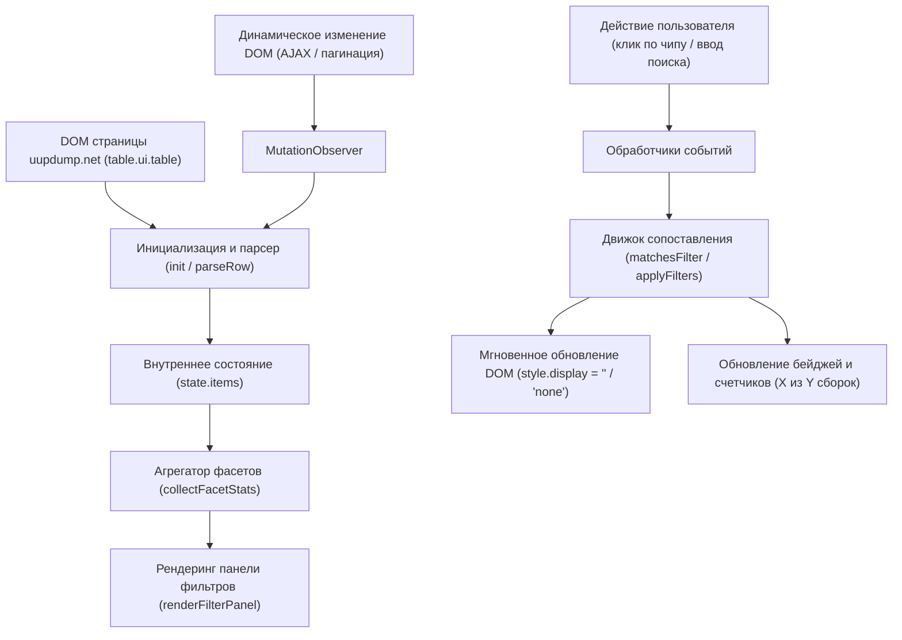

# Архитектурный атлас проекта UUP dump Dynamic Build Filters

В данном документе описывается компонентная архитектура, поток данных и модель взаимодействия юзерскрипта с DOM-деревом сайта UUP dump.

---

## 1. Диаграмма потоков данных (Data Flow)

---

## 2. Структура модулей и зоны ответственности

### 2.1. Parser Module (`parseRow`, `normalizeArch`, `detectOS`, `detectBranch`)
- **Ответственность:** Извлечение чистых структурированных метаданных из HTML-элементов `tr` и `td`.
- **Вход:** Элемент `HTMLTableRowElement`.
- **Выход:** Нормализованный объект записи сборки:
  - `arch`: `x64` | `arm64` | `x86` | `other`
  - `os`: `Windows 11` | `Windows 10` | `Windows Server` | `Windows CPC OS` | `Other OS`
  - `version`: `26H2` | `24H2` | `23H2` | `22H2` | `1809` и др.
  - `branch`: `rs_prerelease` | `rs_flight` | `ge_release` и др.
  - `updateType`: `Insider Preview` | `Cumulative Update` | `Feature Update` | `Standard Build`
  - `buildNumber`: e.g. `26300.9807`, `29695.1001`
  - `uuid`: уникальный идентификатор сборки из URL
  - `searchableText`: объединенная строка в нижнем регистре для быстрого полнотекстового поиска.

### 2.2. Facet Engine (`collectFacetStats`, `createChipGroup`)
- **Ответственность:** Агрегация уникальных значений атрибутов с подсчетом доступных сборок по каждому значению.
- **Особенность:** Динамическое создание фасетов. На экране отображаются только те категории, которые присутствуют на текущей странице, что устраняет визуальный шум.

### 2.3. Filter Matching Engine (`matchesFilter`, `applyFilters`)
- **Ответственность:** Оценка каждой строки на соответствие активным фильтрам и поисковым ключевым словам.
- **Правило логики:**
  - `category_1 IN activeSet_1 AND category_2 IN activeSet_2 ... AND (all queryTokens in searchableText)`
- **Быстродействие:** Прямое переключение свойства `display` (`''` или `'none'`) без перестройки DOM, что гарантирует время отклика < 15 мс даже на больших таблицах.

### 2.4. UI Component (`renderFilterPanel`, `updateChipStyles`)
- **Ответственность:** Построение интуитивной панели над таблицей.
- **Интеграция:** Использование классов Semantic UI (`ui segment`, `ui button`, `ui label`, `ui input`) обеспечивает полную совместимость со светлой и темной темами оформления UUP dump.
