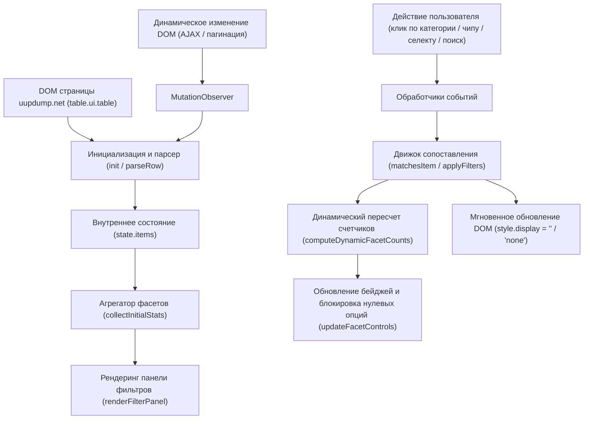

# Архитектурный атлас проекта UUP dump Dynamic Build Filters

В данном документе описывается компонентная архитектура, поток данных и модель взаимодействия юзерскрипта с DOM-деревом сайта UUP dump.

---

## 1. Диаграмма потоков данных (Data Flow)

---

## 2. Структура модулей и зоны ответственности

### 2.1. Parser Module (`parseRow`, `detectPackageCategory`, `normalizeArch`, `detectOS`, `detectBranch`, `detectType`, `detectBuildNumber`, `detectVersion`)
- **Ответственность:** Извлечение чистых структурированных метаданных из HTML-элементов `tr` и `td`.
- **Выход:** Нормализованный объект записи сборки:
  - `packageCategory`: `'Полные сборки'` | `'Обновления'`
  - `arch`: `x64` | `arm64` | `x86` | `other`
  - `os`: `Windows 11` | `Windows 10` | `Windows Server` | `Windows CPC OS` | `Other OS`
  - `version`: `26H2` | `24H2` | `23H2` | `22H2` | `1809` и др.
  - `branch`: `rs_prerelease` | `rs_flight` | `ge_release` и др.
  - `updateType`: `Standard Build` | `.NET Framework Update` | `Cumulative Update` | `Preview Update` | `Feature Update`
  - `buildNumber`: e.g. `26300.9807`, `26300.10008`
  - `uuid`: уникальный идентификатор сборки из URL
  - `searchableText`: объединенная строка в нижнем регистре для быстрого полнотекстового поиска.

### 2.2. Facet Engine & Dynamic Recalculation (`computeDynamicFacetCounts`, `createChipGroup`, `createDropdownGroup`)
- **Ответственность:** Агрегация уникальных значений и динамический расчет доступного количества сборок в контексте других активных фильтров.
- **Особенность:** Блокировка пустых чипов (`count === 0` $\rightarrow$ `disabled`, полупрозрачность и запрет клика) и автоматическое сокрытие пустых групп.

### 2.3. Filter Matching Engine (`matchesItem`, `applyFilters`)
- **Ответственность:** Оценка каждой строки на соответствие активным фильтрам и поисковым ключевым словам.

### 2.4. UI Component (`renderFilterPanel`, `updateFacetControls`)
- **Ответственность:** Построение интуитивной панели над таблицей:
  - **Пункт №1 (Верхний):** группа «Категория» (`Полные сборки` / `Обновления`).
  - Чипы для Архитектуры, ОС, Релиза, Ветки, Типа сборки.
  - Компактный выпадающий список `<select>` для сборок (Build) с мини-кнопкой сброса `[✖]`.
